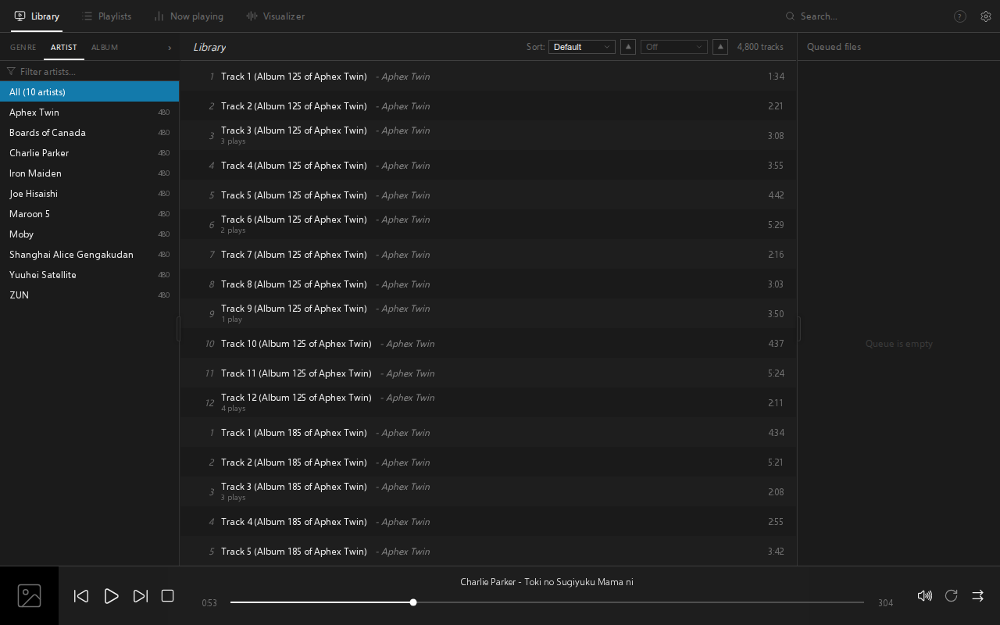

# Crescendo

A dark desktop music player for Linux, inspired by the [**Eole** theme](https://github.com/Ottodix/Eole-foobar-theme) for [foobar2000](https://www.foobar2000.org/).

Built with **Tauri 2**, **Svelte 5**, and **GStreamer**.



## Features

- sleek dark user interface
- library view with two main versions: album wall or a track list view
- powerful searching & filtering capabilities
- last.fm support for additional artist details
- MPRIS media controls, and a KDE Plasma system-tray widget with cover art, song info and transport controls
- designed for large libraries; the player is tested with a library containing 100k+ songs

## Stack

- **Shell**: Tauri 2 (WebKitGTK) + SvelteKit (static adapter, SPA)
- **Playback**: GStreamer `playbin3` on a dedicated Rust thread — FLAC, MP3,
  Opus, Vorbis, WAV, AAC; gapless via `about-to-finish`
- **Library**: SQLite (WAL) at `~/.local/share/crescendo/library.db`;
  incremental scans are stat-only (mtime/size diff), tags read with lofty
- **Search**: Query syntax compiled to SQL inspired by [Quod Libet](https://github.com/quodlibet/quodlibet)
- **Art**: no blobs in the DB; `folder.jpg`/embedded art resolved lazily,
  256px thumbnails cached in `~/.cache/crescendo/thumbs/`, served over the
  `crescendo-art://` protocol, icons provided by [Lucide](https://github.com/lucide-icons/lucide)
- **Now Playing**: Last.fm artist/album info (API key set in Settings, 30-day
  cache) with local-tag fallback

## Workspace layout

```
crates/core/   # crescendo-core: db, scanner, search, playlists, m3u, art, lastfm
               # (no UI deps — builds and tests standalone)
src-tauri/     # tauri shell: player engine, commands, art protocol
src/           # SvelteKit frontend (runs against a mock backend in plain vite dev)
reference/     # the original Eole foobar2000 theme (visual source of truth)
static/fonts/  # Selawik (SIL OFL) — metric-compatible Segoe UI substitute
```

## Building

One-time system setup (Fedora):

```bash
curl --proto '=https' --tlsv1.2 -sSf https://sh.rustup.rs | sh -s -- -y
sudo dnf install -y webkit2gtk4.1-devel openssl-devel file libappindicator-gtk3-devel \
  librsvg2-devel gcc-c++ gstreamer1-devel gstreamer1-plugins-base-devel
npm install
```

Run in development / build a release bundle:

```bash
npm run tauri dev
npm run tauri build
```

Frontend-only preview (mock library, no Rust needed): `npm run dev` → http://localhost:1420

Core tests and the scanner smoke test:

```bash
cargo test -p crescendo-core
cargo run --release -p crescendo-core --example smoke -- <music-dir> <db-path>
```

## Plugins

Crescendo supports optional local declarative plugins: validated data packages
that contribute host-rendered settings, filter-menu controls, and trusted
library facet transforms without executing plugin code. Plugins start disabled,
loaded-set changes apply after restart, and setting values apply live.

The [plugin SDK](plugin-sdk/README.md) contains manifest schema version 1, the
supported deterministic validator/packer, the canonical Primary Grouping
example, compatibility rules, and installation/safe-mode documentation.

## Plasma system-tray widget

Crescendo publishes itself over MPRIS, so media keys, the lock screen and
Plasma's own Media Player applet work out of the box. The `plasmoid/` folder
also holds a dedicated KDE Plasma 6 widget: cover art as the background, the
album artist and title, a seek bar, previous / stop / play-pause / next, and a
right-click "Stop after this song" on the stop button. The deb and rpm
packages install it under `/usr/share/plasma/plasmoids/`; from a checkout:

```bash
kpackagetool6 --type Plasma/Applet --install plasmoid/dev.crescendo.tray
```

It appears in the system tray while Crescendo is running (log out and back in,
or restart `plasmashell`, after the first install).

## Keyboard shortcuts

Space play/pause · ←/→ seek ±5s · `/` focus search · scroll wheel over the
volume icon adjusts volume · Esc closes the cover window
